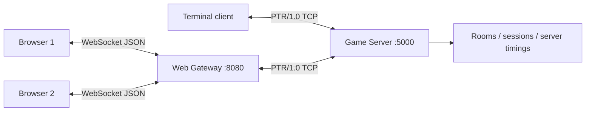

# KeySprint — Real-time Multiplayer Typing Arena

> **Course:** Network Programming (INT1433) · PTIT · Instructor: Dr. Hung N. Dang
>
> A typing practice website with a **server-authoritative multiplayer race**, powered by a documented custom length-prefixed TCP protocol (PTR/1.0).

**Important:** This is an AI-assisted implementation draft to be studied, reviewed and tested by the student team. The team must finish its own member/contribution records, verify Docker deployment and attach real demo screenshots. The unchanged authoritative assignment is [`INSTRUCTION.md`](INSTRUCTION.md).

## 1. Team (mandatory — complete yourselves)

| # | Full name | Student ID | Class | GitHub | Role |
|:-:|---|:---:|---|---|---|
| 1 | | | | | |
| 2 | | | | | |
| 3 | | | | | |

**Topic:** Real-Time Multiplayer Typing Race using a Custom TCP Application-Layer Protocol.

## 2. Problem & Idea (A1)

- **Problem:** Solo typing sites do not automatically provide a private, lightweight, synchronized race among study-group members.
- **Idea:** Practice independently by number of pages (1, 2, 3) or time (1, 3, 5 minutes), then challenge friends in 2–8-player rooms with an invite link, lobby readiness, common countdown, synchronized typing progress and ranked finish times.
- **Non-trivial network problem:** TCP framing, concurrent sessions/rooms, fair progress verification, phase transitions, slow clients, malformed packets, disconnect handling and host migration.
- **Out of scope:** Imported Typing.com assets; account registration, persistence, multi-game catalog and robust commercial anti-cheat.

See [`docs/proposal.md`](docs/proposal.md).

## 3. Features / Implementation Status

- [x] Separate TCP game server, CLI client and browser WebSocket gateway
- [x] PTR/1.0 own length-prefixed JSON protocol with command/status documentation
- [x] Concurrent asyncio connections and single event-loop authoritative room state
- [x] Handling malformed frames, timeouts, abrupt disconnect and slow sockets
- [x] Practice time 1/3/5 minutes, page 1/2/3, local visual cursor, mistake feedback, synthetic sound, virtual keyboard, WPM/accuracy
- [x] Create / join room (6-character invite code), 2–8 players, ready and host start
- [x] Shared server-controlled countdown, valid-prefix progress, synchronized rankings
- [x] Server transfer of host on disconnection; delete empty rooms
- [x] Actual TCP integration tests + actual WebSocket/HTTP gateway tests
- [ ] Verified **clean Docker build** on Docker-equipped machine (team task)
- [ ] Manual browser demonstration screenshots, recorded by team
- [ ] Optional other game modes/accounts/race history

**Reference used for feature categories:** [Typing.com typing tests](https://www.typing.com/student/tests). WPM and accuracy conventions: [Typing.com support](https://support.typing.com/en/articles/9048321). KeySprint's UI, passages, and sounds are original rather than copies of their protected assets.

## 4. Architecture (A2/A3)



| Aspect | Chosen technology | Why |
|---|---|---|
| Server | Python 3.12, `asyncio` streams | Nonblocking, concurrent clients; room state owned by one event loop |
| Transport | TCP | In-order, reliable control/progress |
| Framing | 4-byte big-endian payload length | Handles split/coalesced TCP reads |
| Protocol | JSON messages, `PTR/1.0` | Own application-layer command and status model |
| UI | HTML/CSS/JavaScript, original design | Responsive experience with no browser framework build step |
| Gateway | Python `aiohttp` WebSocket/TCP bridge | Browsers cannot use raw TCP; game authority remains on TCP server |
| Shared state | In-memory state owned by server event loop | No multiple threaded writers or lock-order problems |

Design details: [`docs/protocol-design.md`](docs/protocol-design.md), [`docs/architecture.md`](docs/architecture.md). Suggested next steps: [`docs/roadmap.md`](docs/roadmap.md), [`docs/oral-defense.md`](docs/oral-defense.md), [`docs/integration-guide.md`](docs/integration-guide.md).

## 5. Quick Start

### Docker Compose (recommended)

From the repository root:

```bash
cp .env.example .env   # PowerShell: Copy-Item .env.example .env

docker compose up --build
```

`server` and `web` start; open **http://localhost:8080** in your browser. Open a second browser (or private/incognito window) for another guest. If you change `WEB_PORT`, use that configured port.

**Required terminal client:**

```bash
docker compose run --rm client
```

Type `create`, `join ABC123`, `ready`, `start`, `state`, `progress TEXT`, `ping`, `leave`, `quit` as appropriate. This is a raw TCP client (same protocol) designed for oral-defense demonstrations, not the preferred full typing UI.

Stop:

```bash
docker compose down
```

### Native Python (without Docker)

Requires Python 3.12 or later:

```bash
python -m pip install -r client/requirements.txt
```

Terminal A, PowerShell:

```powershell
$env:SERVER_HOST="127.0.0.1"; $env:SERVER_PORT="5000"; python server/src/server.py
```

Terminal B:

```powershell
$env:CLIENT_TARGET_HOST="127.0.0.1"; $env:CLIENT_TARGET_PORT="5000"; $env:WEB_HOST="127.0.0.1"; python client/src/web_gateway.py
```

Browser: **http://localhost:8080**. Optionally in Terminal C run `python client/src/client.py` with the same `CLIENT_TARGET_*` settings.

**Changing nickname:** In the Race landing page enter a nickname *before* creating/joining a room. Browser sessions represent temporary guest identities; no account persistence. For a second local browser tab use a separate session (private/incognito) or distinct browser; each tab has its own WebSocket connection.

## 6. How to Demo Race

1. Open `http://localhost:8080` in two browser windows, navigate to **Đua tốc độ**.
2. Enter nickname and **Tạo phòng mới** in A. Copy link or 6-character room code.
3. Join from B; both players click **Sẵn sàng**.
4. Host clicks **Bắt đầu race**. Observe server-controlled 3-second countdown and shared paragraph.
5. Type as accurately as possible; compare synchronized progress bars, position and WPM; finish text to receive a server-verified finish time. A room also ends at the 180-second cap.
6. Abruptly close B and confirm A remains connected; check cleanup/host transfer.

## 7. Testing (B1/B2)

```bash
python -m unittest discover -s tests -v
```

At implementation time **7 automated integration tests passed** with real TCP sockets and a real HTTP/WebSocket gateway, including a 40-client connection test and verified two-player race results. See [`docs/testing-guide.md`](docs/testing-guide.md) for exact executed command/output and **pending manual verification**. A clean Docker test was **not** possible in the authoring environment; the team must verify it and record evidence.

## 8. AI Disclosure (mandatory — team review required)

Policy: [`INSTRUCTION.md` §7](INSTRUCTION.md#7-ai-usage-policy). Substantial AI use **must** be disclosed. This project's current draft contains AI-generated code, documentation and tests; this fact must remain disclosed even if the team later revises them.

### 8.1 Summary

| Tool / model | Used by | Used for | Files / modules | Level |
|---|---|---|---|---|
| ChatGPT / GPT-6 | *(team must identify requester/reviewer)* | Drafted networking implementation, browser UI, protocol/architecture/docs and integration tests | `server/src`, `client/src`, `tests`, `docs` | **Generated** (initial draft; update after team revisions) |

**Levels:** Assist — advice/review. Co-write — AI draft substantially rewritten. Generated — AI wrote most of it; student checked and can defend it.

### 8.2 Decisions confirmed by our team

*(Team to fill after reviewing trade-offs in proposal and architecture: TCP vs UDP, asyncio vs threads, custom length framing, gateway separation, protocol error recovery.)*

### 8.3 AI proposals corrected or rejected

*(Team to fill with a real bug/design change it discovered, reproduction and correction. Do not fabricate.)*

### 8.4 Full usage log

See [`docs/ai-log.md`](docs/ai-log.md) — add your actual review/evidence for significant AI sessions.

## 9. Contribution (mandatory — do not fill using assumptions)

| Member | Owns (modules / documents) | Key PRs / commits | AI-assisted parts | Contribution % |
|---|---|---|---|:---:|
| | | | | |
| | | | | |
| | | | | |

We confirm the table above is accurate and agreed by all members:

- [ ] Member 1
- [ ] Member 2
- [ ] Member 3

---

<sub>Based on the [network-programming-starter](https://github.com/hungdn1701/network-programming-starter) template by Hung N. Dang.</sub>
