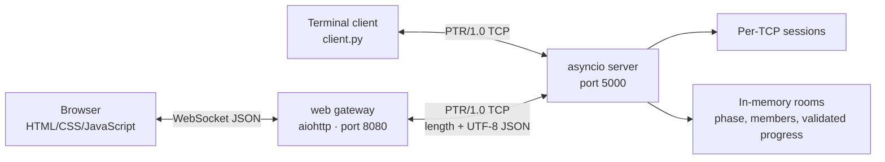
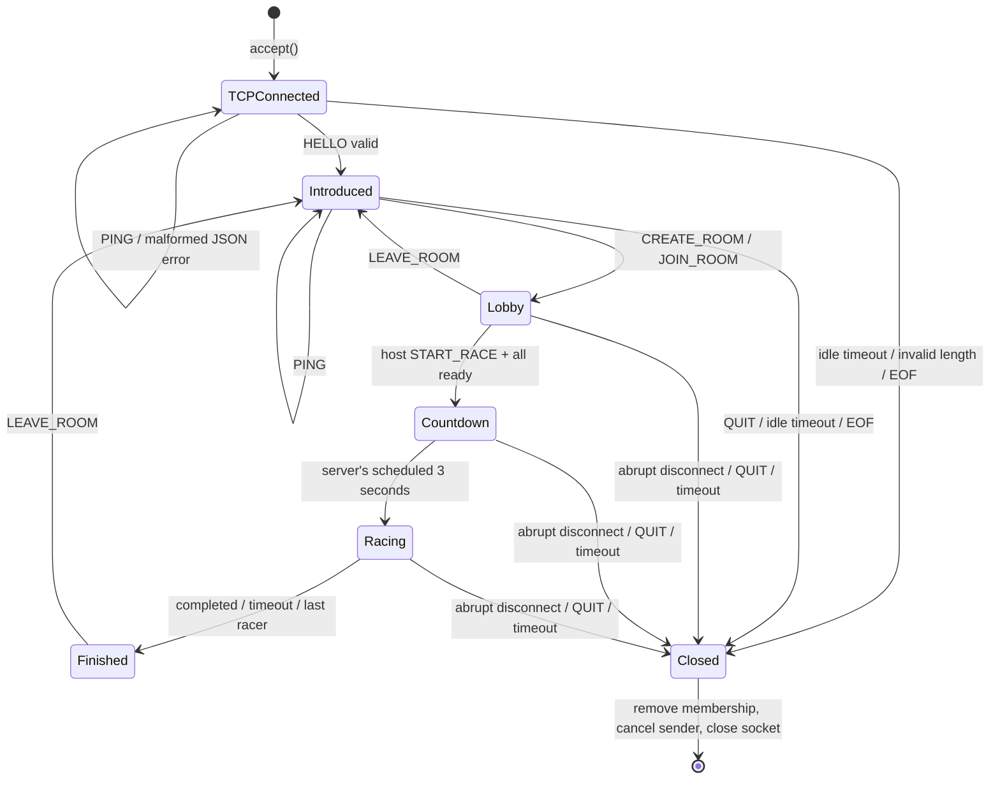

# KeySprint — System Architecture & Concurrency Design (A3)

## 1. Overview: three independently running programs

- `server/src/server.py`: **the only game authority** (room creation, membership, readiness, countdown, validation, finish time).
- `client/src/wire.py`: a **separately implemented** client-side frame codec; it does **not import** server code.
- `client/src/web_gateway.py`: independent WebSocket-to-TCP adapter. Every WebSocket client opens its **own TCP connection**, so clean disconnect maps to server session cleanup. Does not know about room rules.
- `client/src/client.py`: required instructor-friendly raw TCP terminal client for `docker compose run --rm client`.
- `client/src/static/*`: interactive web interface; solo practice runs locally, multiplayer is driven by server state.
- `shared/`: intentionally has no executable shared code; the protocol specification is the client–server contract.

## 2. Concurrency Model

**Model:** Python `asyncio` nonblocking TCP streams, **one event loop per server process**; one coroutine per connection and a separate coroutine per socket writer, plus one small countdown/timer task per active room.

- `asyncio.start_server` accepts concurrent connections without holding up the accept loop.
- Each client reader loops on `readexactly(4)` then `readexactly(N)` with a 90-second idle timeout, dispatches messages, then repeats.
- Game commands are implemented as **no-await critical sections** in `GameServer.dispatch()`; between entry and exit they mutate shared dictionaries only on the single event loop, so no two state transitions interleave midway.
- `GameServer.broadcast()` **only enqueues** pre-serialized messages. It does not wait for network I/O while modifying the room.
- Each peer has an outbound `asyncio.Queue(maxsize=128)` and an independent write task with a 5-second drain timeout. Unresponsive peers are disconnected.
- The room lifecycle uses `asyncio.sleep(3)` and `asyncio.sleep(180)`; these sleeps are **per-room tasks**, not blocking sleeps in a client handler.

**Why not threads?** Thread-per-client would require locks around the room/member dictionaries and careful avoidance of locks during socket writes. The event loop model reduces accidental races and resource use for hundreds of concurrent connections. **Limitation:** CPU-heavy text analysis, database calls or synchronous file I/O would block everyone; offload such work if added. This is **not** a distributed/multi-process authoritative state model.

## 3. Shared State and Protection

| Shared object | Accessed by | Protection strategy |
|---|---|---|
| `GameServer.clients` | Accept, handlers, disconnect | Single event loop, add/remove without awaits |
| `GameServer.rooms` | All command handlers, race timers, disconnect | Same loop, mutations in await-free critical sections |
| `Room.racers` and `Room.phase` | Join/leave/ready/start/progress/timers | Same loop; validation and transition atomic within one synchronous dispatch run |
| `Client.outbound` | Dispatcher and writer task | Native `asyncio.Queue` (thread-safe **not** needed; single loop) |
| `Client.closing` | Reader and writer tasks | One event loop flag; close idempotently |
| Browser `race.room` display state | JS events/UI | Single browser JS event loop; only network ROOM_STATE replaces authoritative snapshot |

**Deadlock:** no locks are acquired. **Starvation concern:** event-loop handlers must remain short and cannot call blocking I/O; expensive logic must be moved elsewhere. **Backpressure:** bounded queues and `drain` timeout stop a slow peer from consuming unlimited memory. **Fairness:** server time determines finish rather than client clocks.

## 4. Connection Lifecycle

Note that the **client's TCP session state** and a **room's race state** are separate; `Finished` means race state, not a required network disconnect. New room only after leaving old one. Host migration happens during disconnect; all members receive a revised snapshot. The room is deleted after its last member leaves, and its pending race timer task is canceled.

## 5. Race Timing, Updates, and Score

1. Host starts only if >=2 players and every racer is ready; the server captures **monotonic start +3s** and broadcasts a corresponding Unix-millisecond start for UI.
2. Browser displays a countdown using `serverUnixMs` to approximate its clock skew; **this display is not used for authority**.
3. Client sends its whole **correct prefix** on progress. Server verifies `text.startswith(typed)`, strictly non-decreasing progress and plausibility bound, and records `len(typed)`.
4. Server pushes throttled snapshots to all room members. Players see concurrent progress bars.
5. Server records finish elapsed with monotonic clock if full text matches. Results rank verified finish elapsed, with DNF below finished entrants. Unfinished racers are marked DNF at the room's 180s cap.
6. Correct-text WPM shown by the server is derived from `correct chars / 5 / elapsed minutes`. In solo practice, WPM is based on printable keystroke attempts, including errors, and accuracy is `(attempts-errors)/attempts`.

**Limitation:** network transit latency affects when final progress is received. Not perfectly latency-neutral competitive timing; a future edition could apply clock synchronization and carefully bounded compensation with security trade-offs. This version does not claim to eliminate cheating.

## 6. Failure Cases & Recovery

| Failure | Behavior |
|---|---|
| TCP data split across recv calls | `readexactly` collects the frame |
| Multiple messages in one TCP packet | Decoder processes one length-prefixed message at a time |
| Invalid JSON / invalid UTF-8 | Code 400 event, keep connection |
| Invalid/oversized length | Code 413 event, close offending connection |
| Unrecognized/out-of-phase command | Command-specific error code, no state mutation |
| Client aborts while in room | Remove player; transfer host; notify remaining racers |
| Client sends nothing | Reader timeout closes it; gateway has PING every 25s |
| Slow client never reads | Queue max 128 + 5s write timeout, then disconnect |
| Gateway unavailable | Browser race fails but raw TCP server/terminal can still operate |
| Server restart | Ephemeral rooms/sessions lost; browser must reconnect, no automatic race resume |

## 7. Deployment

| Component | Runtime | Host port | Internal address |
|---|---|---|---|
| `server` | Python 3.12 slim (`server/Dockerfile`) | `${SERVER_PORT:-5000}` | `server:${SERVER_PORT}` |
| `web` | Python 3.12 slim / aiohttp (`client/Dockerfile`) | `${WEB_PORT:-8080}` | Talks to `server` by Compose DNS |
| `client` | Same client image, terminal command | No inbound port | Talks to `server` by Compose DNS |

- `docker compose up --build` starts `server` and `web`; profile-gated `client` remains a separately invoked interactive application.
- Inside Docker server binds `0.0.0.0`, never `localhost`; gateway also listens on `0.0.0.0` inside its container.
- Native dev runs: `SERVER_HOST=127.0.0.1 SERVER_PORT=5000 python server/src/server.py`, then `CLIENT_TARGET_HOST=127.0.0.1 CLIENT_TARGET_PORT=5000 WEB_HOST=127.0.0.1 python client/src/web_gateway.py`.
- Do not embed secrets or private keys in source; `.env` is ignored by Git, `.env.example` lists supported settings.

## 8. Important Trade-offs and Next Steps

| Decision | Rejected approach | Reason |
|---|---|---|
| TCP custom protocol | WebSocket-only game service | Direct demonstration of framing, raw sockets, protocol specification |
| Event loop authority | Shared mutable state across client threads | Simpler correctness and lack of locks for a classroom-sized service |
| WebSocket gateway | Browser-only raw TCP | Raw TCP unavailable from browser JS |
| Guest-only private rooms | Accounts and social matching | Smaller scope means stronger B1 tests and clearer oral defense |
| Text prefix validation | Trust browser progress percentage | Reduces basic score manipulation and simplifies proof |
| No persistent storage | Database for all rooms and results | Avoids unnecessary dependency; persistence is a future extension |

## 9. Mapping to Rubric

- **A1:** `docs/proposal.md` scope, alternatives, identified networking problem.
- **A2:** `docs/protocol-design.md` framing, exact envelope, statuses, state machines, 2 sequence diagrams.
- **A3:** this document, concurrency and shared-state table, lifecycle.
- **B1:** `tests/test_protocol.py` fragmented/coalesced frames, 40 simultaneous clients, disconnect, malformed/oversized data, race validation and finish ranking.
- **B2:** `tests/test_gateway.py` browser gateway two players; web UI manual scenario still requires team verification.
- **B3:** Dockerfiles, Compose, `.env.example`, README quick start; clean Docker verification must be performed on a Docker-equipped machine.
- **C:** each teammate reads/changes their claimed code and practices the oral-defense questions in `.ai/ai-guide.md`.
