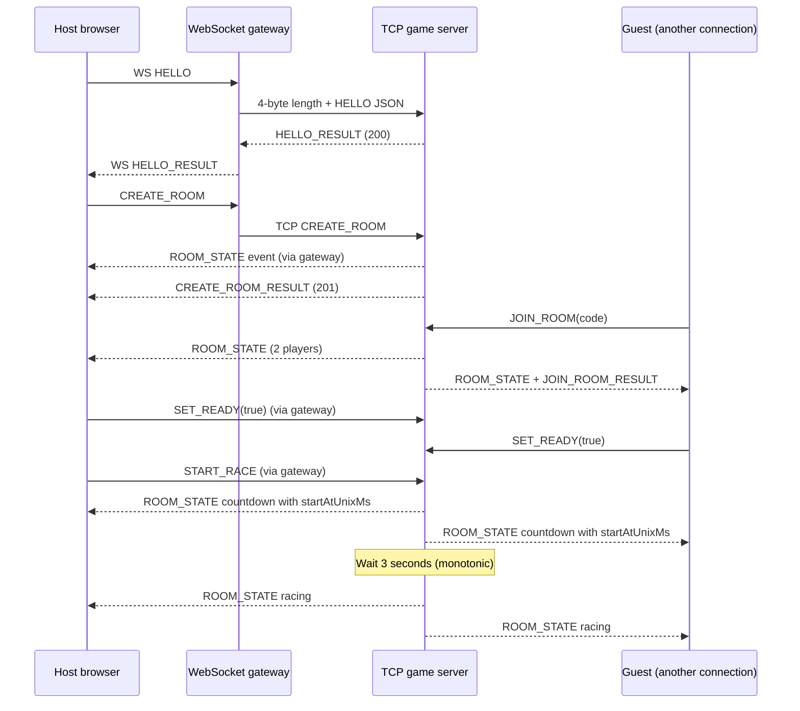
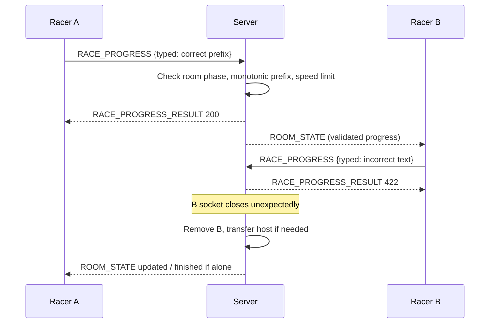

# PTR/1.0 — KeySprint Application Protocol Specification

> Protocol implemented by `server/src/server.py` and independently by `client/src/wire.py`. Update **this file and both implementations** whenever messages change. The source of truth for mandatory requirements is the unmodified `INSTRUCTION.md`.

## 1. Overview

| Property | Value | Rationale |
|---|---|---|
| Name/version | **PTR/1.0** (Practice Typing Race) | Version reported at HELLO to support later changes |
| Transport | **TCP** | Reliable ordered delivery of game control and progress; avoids UDP retransmit design |
| Host/port | `SERVER_HOST` / `SERVER_PORT` (default 0.0.0.0:5000 in container) | No fixed machine IP |
| Framing | **4-byte big-endian unsigned length** + N JSON bytes | Correct for fragmented/coalesced TCP reads; unambiguous framing |
| Encoding | **UTF-8 JSON** | Easy inspection and extensibility |
| Maximum payload | **16,384 bytes** | Reject oversized frames before allocating body |
| Session | Stateful **per TCP connection** (guest identity bound to connection) | Simplifies room membership and disconnect cleanup |
| Browser adaptation | Browser → WebSocket → independent gateway → **PTR/1.0 TCP** → server | Browser cannot create raw TCP sockets; gateway forwards objects without making game decisions |

## 2. Exact Wire Frame

```
TCP stream
 ┌────────────────────────────────┬────────────────────────────────────────┐
 │ uint32 length (4 bytes, BE)    │ JSON UTF-8 payload (length bytes)      │
 └────────────────────────────────┴────────────────────────────────────────┘
```

- Length must be in `[1, 16384]`. `0` or `>16384` causes an `ERROR` event with code **413** followed by closing that connection.
- Decoder reads **exactly 4** bytes, then **exactly N** bytes (never assumes one `recv` == one message).
- Invalid UTF-8 or invalid JSON: `ERROR` event code **400**, connection remains open for a subsequent valid frame.
- Decoder/handler is independent in client and server. For a test of fragmentation and coalescing see `tests/test_protocol.py`.
- JSON payload with literal `\n` is safe; newline is **not** the delimiter.

## 3. Message Envelope and Roles

Client request:

```json
{"type":"HELLO","requestId":"1","payload":{"name":"Alice"}}
```

Server reply (one per request):

```json
{"type":"HELLO_RESULT","requestId":"1","code":200,"status":"OK","data":{"id":"a1b2c3d4","name":"Alice","version":"PTR/1.0"},"message":""}
```

Asynchronous server event (may arrive **before** a request reply):

```json
{"type":"ROOM_STATE","data":{"code":"A1B2C3","phase":"lobby","players":[]}}
```

- `type`: command string. `requestId`: string ≤64 characters, echoed in reply for correlation. `payload`: JSON object.
- `*_RESULT`: success or rejection of a client command; `code` and `status` describe its outcome. `ROOM_STATE` and `ERROR` are uncorrelated push events.
- The gateway **does not interpret or own race state**. The browser sends/receives the same JSON objects over WebSocket; the gateway adds/removes the TCP length prefix.
- Names support UTF-8, are trimmed, 1–20 characters, no control characters. No password/account login in v1.0.

## 4. Commands (all client → server)

| Command | `payload` | Success result data | Important constraints |
|---|---|---|---|
| `HELLO` | `{"name":"Alice"}` | `id,name,version` | Once per connection; required before game commands |
| `PING` | `{}` | `serverUnixMs` | Heartbeat; works before HELLO |
| `CREATE_ROOM` | `{}` | `code` | Must not already be in a room; max 100 rooms |
| `JOIN_ROOM` | `{"code":"A1B2C3"}` | `code` | Only in lobby, room exists and has `<8` players |
| `GET_STATE` | `{}` | room snapshot | Must belong to a room |
| `LEAVE_ROOM` | `{}` | `left` | Changes membership; may transfer host |
| `SET_READY` | `{"ready":true}` | `ready` | Lobby only, boolean required |
| `START_RACE` | `{}` | `startAtUnixMs` | Host only; ≥2 players and **all ready** |
| `RACE_PROGRESS` | `{"typed":"A small..."}` | `accepted` (character count) | Race phase only; exact correct prefix, no rollback or implausible jumps |
| `QUIT` | `{}` | `bye` | Acknowledged, then socket closes |

**Server events:**

- `ROOM_STATE`: pushed whenever membership, readiness, phase, visible progress or outcome changes. Contains `code`, `hostId`, `phase`, `text`, `startAtUnixMs`, `serverUnixMs`, `players`.
- `ERROR`: for invalid framing/JSON or idle timeout, with `data.code` and `data.message`.
- `ROOM_STATE.players[]`: `{id,name,ready,correct,length,wpm,finishSeconds,dnf}`. `finishSeconds` is `null` for unfinished players.

## 5. Room and Race State Machine

```mermaid
stateDiagram-v2
    [*] --> lobby: CREATE_ROOM
    lobby --> lobby: JOIN_ROOM / SET_READY / LEAVE_ROOM
    lobby --> countdown: START_RACE [host; >=2; all ready]
    countdown --> racing: server 3-second timer
    racing --> racing: validated RACE_PROGRESS
    racing --> finished: all remaining racers finish, or 180s timeout, or one remains
    finished --> [*]: last player leaves
```



- Room codes are 6 uppercase hexadecimal characters generated by cryptographically secure randomness. They are **invite codes, not authentication secrets**.
- One TCP connection corresponds to one guest; the same guest may join one room at a time.
- The server chooses the shared passage at room creation (original sample passages, currently rotated from a fixed set). Guests **cannot choose their own race text**.
- At start, server schedules a single monotonic `start_mono` plus **3 seconds** and publishes wall-clock `startAtUnixMs` for client display. Server refuses progress before the monotonic start.
- All progress must be an **exact prefix** of the server's shared text. It cannot regress, exceed text length, or jump faster than the conservative `12 + 35 × seconds_elapsed` character envelope. This only deters naive progress spoofing, not sophisticated automation.
- Server marks a racer finished only when `typed == entire shared text`; then uses server monotonic elapsed to determine time and ranking. Browser WPM/errors are cosmetic; rankings are not based on client-provided metrics.
- Progress broadcasts are rate-limited per racer to **at most approximately 10 per second** (finish bypasses limit). Browser sends at most approximately once per 95ms.
- Host disconnects: host transferred to first remaining member. Room removed when empty. When only one player remains in an active race, room becomes `finished`.
- After a room finishes, users leave and create/join a new room; **rematch in-place is not implemented**.

## 6. Error Codes

| Code | Meaning | Example |
|---:|---|---|
| 200 | OK | `PING`, successful command |
| 201 | CREATED | `CREATE_ROOM` |
| 400 | BAD_REQUEST | Missing name, unknown command, malformed JSON event |
| 401 | UNAUTHORIZED | Game command before `HELLO` |
| 403 | FORBIDDEN | Non-host starts race |
| 404 | NOT_FOUND | Room code does not exist |
| 408 | TIMEOUT | No complete frame within `READ_TIMEOUT` |
| 409 | CONFLICT | Race already started, not ready, double join |
| 413 | TOO_LARGE | Frame length invalid |
| 422 | UNPROCESSABLE | Wrong prefix or impossible speed |
| 503 | UNAVAILABLE | Max rooms/clients or gateway cannot connect to game server |

Command-related errors are `COMMAND_RESULT` with `status:"ERROR"` and `message`. Framing/timeout errors use asynchronous `ERROR` events. Invalid JSON can be recovered; forbidden sizes and idle timeout close the offending socket; **other clients continue**.

## 7. Sequence Diagrams

### 7.1 Create/join/start



### 7.2 Progress / anti-cheat rejection / disconnect



## 8. Limits, Timeout and Defensibility

| Setting | Value | Rationale |
|---|---:|---|
| TCP frame payload | 16 KiB | Prevents unbounded memory consumption |
| Socket idle read (`READ_TIMEOUT`) | 90s default | Dead connection cleanup |
| Gateway TCP PING | Every 25s | Keep connected browser active during lobby |
| TCP outbound messages/client | 128 | Slow client cannot grow unbounded queue |
| TCP `drain()` timeout | 5s | Disconnect non-reading client |
| Max concurrent TCP clients | 200 default | Bound resource use |
| Max in-memory rooms | 100 default | Bound memory use |
| Max racers/room | 8 | Small group design |
| Countdown | 3s | Consistent server-controlled race start |
| Race duration cap | 180s | Prevent endless active race |
| Persistent data | None | Current version is ephemeral; restart clears rooms |

**Rationale and oral-defense trade-offs:** TCP chosen over UDP because losing one progress update should not reorder an authoritative race sequence; length-prefix vs newline supports embedded whitespace and unambiguous byte boundaries; `asyncio` vs threads avoids locks for game state as long as handlers never await during mutation; gateway vs WebSocket-only game server exposes a demonstrable independent raw TCP protocol, at the cost of one extra deployment component and hop.

**Security limitations:** Guest names are not authenticated; invite codes are not access-control tokens; NAT/time synchronization is approximate; no encrypted TCP between internal containers; race speed heuristics cannot stop scripted clients. For internet deployment use TLS/WSS, authentication, rate limiting, and broader anti-abuse work.
